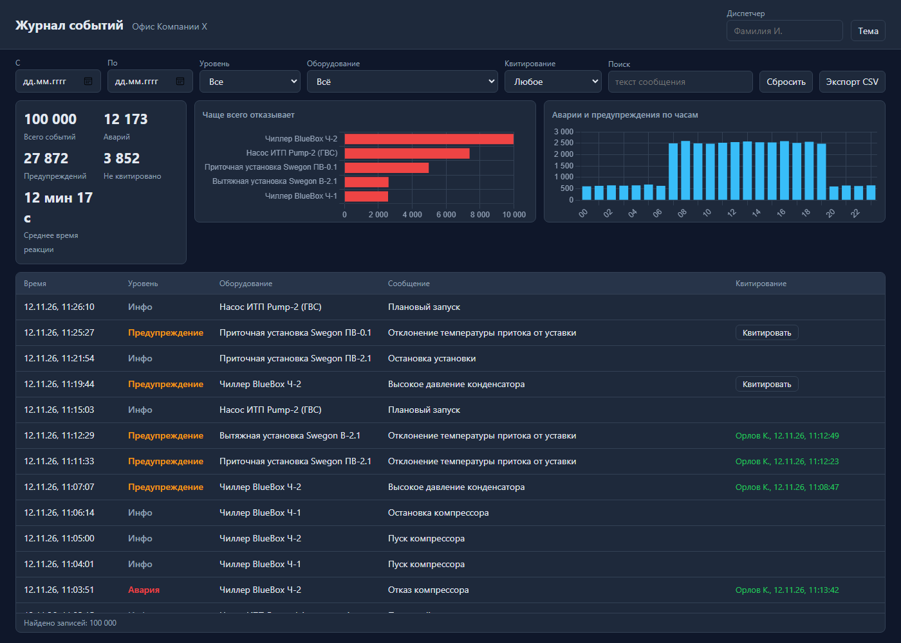

# Журнал событий «Офис Компании Х»

Журнал аварий вентиляции, чиллеров и насосов ИТП. В базе 100 000 событий, фильтрация и
постраничная выдача делаются в SQLite, в браузере работает виртуальная прокрутка.
Продолжение дашборда [office-dashboard](https://github.com/lynxy-coder/office-dashboard).



Что есть: фильтры (период, уровень, оборудование, квитирование, поиск), квитирование аварий,
экспорт в CSV, статистика по выбранным фильтрам, тёмная и светлая темы.

## Запуск

Нужен Node.js 22.13 или новее. Зависимостей нет, SQLite встроен в Node.

```bash
npm start
```

Открыть http://localhost:3000. При первом запуске база создаётся сама, это занимает несколько секунд.
Тесты: `npm test`.
